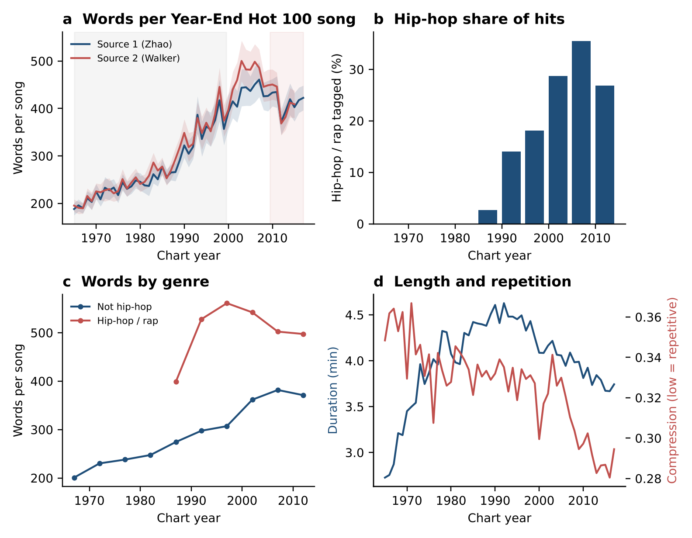
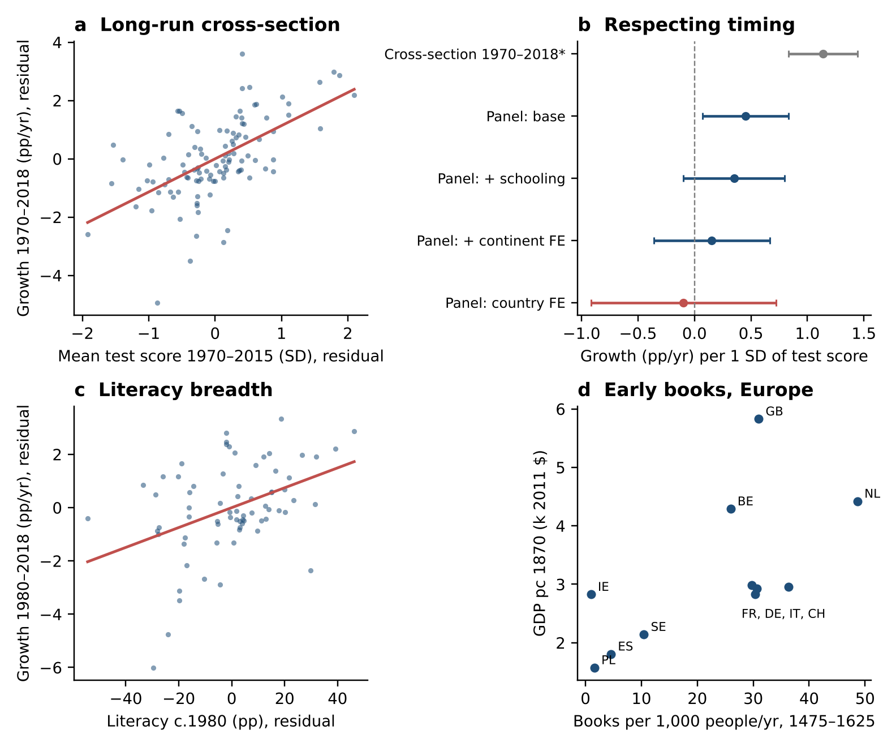

# Words, Meaning and Progress

### Are pop songs getting wordier because we've lost meaning? Do societies rise with the strength of their written word? Two old intuitions, tested on 70 years of hit songs and 158 countries.



---

## The question

There is an old idea that you can read the health of a society from the health of its language. Writing is how humans beat the limits of biology: a gazelle that escapes a lion passes on its legs, not the lesson, but a person can write the lesson down and hand it to strangers not yet born. If language is the medium a civilisation remembers through, then two things should follow.

1. **Societies that command their written language better should progress faster.**
2. **If listeners have lost the ability to feel meaning carried by melody alone, popular music should increasingly spell it out in words.** Put simply: more lyrics, less music.

Both ideas come from a philosophical notebook, *Nemo vir est qui mundum non reddat meliorem* ("no one is a man who does not leave the world better"), kept since 2019. This repository turns them into falsifiable predictions, tests them against public data, and reports what survived.

**Read the full paper:** [report/PAPER.md](report/PAPER.md) (renders here on GitHub) or the [typeset PDF](report/Words_Meaning_Progress_paper.pdf), written in *Nature* article format.

---

## What we found

### Study 2: hit songs really did get wordier, but not in the way the theory predicted

We counted every word in every Billboard Year-End Hot 100 song from **three independently scraped lyric collections** and compared hits from before 2000 with hits after 2010.

- **The headline prediction holds.** Post-2010 hits average **409 words** against **267** before 2000, an increase of **53%** (Cohen's *d* = 1.08). All three sources agree, at +43% to +53%.
- **But the timing is wrong for a post-2010 story.** Words per hit climbed through the 1990s and **peaked in the 2000s at 430**. The 2010s were slightly *lower*. Whatever changed, it changed before smartphones and social media.
- **Rap explains only about a third.** Hip-hop went from 5% to 25% of hits, yet songs with no hip-hop tag *also* gained 47% more words. Rap changed how everyone sings, not just how often rap charts.
- **Songs got denser, not longer.** Tracks shortened by 6%, while **words per minute jumped from 68 to 110 (+62%)**. This was the largest effect we measured, and it matches the notebook's own "shorter notes" hypothesis.
- **More words, less information.** Distinct vocabulary grew by only a third, and lyrics became **14% more repetitive** by a compression measure. Hits now carry more words but less information per word, which is the opposite of "meaning spelled out".

> Popular music did not become more literal. It became rhythmic speech: more syllables per beat, repeated, delivered with more intensity.

### Study 1: literacy predicts growth, test scores mostly don't



We measured how well societies command their written language in three ways (how many people can read, how well they read and reason on standardised tests, and how many books early modern Europeans consumed) and asked whether each predicts later economic growth.

- **Breadth wins.** Across 71 countries, every 10 extra points of literacy in 1980 predicted **0.37 percentage points per year faster growth** through 2018, about **15% higher income** after 38 years. It holds after controlling for schooling and continent.
- **Depth fades once timing is respected.** Test scores look like a powerful growth engine in a simple cross-section (+1.14 points of growth per standard deviation), reproducing a famous result. But when scores are required to come *before* the growth they predict, and continent is controlled for, the effect falls to near zero.
- **Early books mark later wealth.** European countries that read most in 1475 to 1625 (the Netherlands, Britain, Belgium) were among the richest by 1870 (ρ = 0.70, 11 countries, illustrative only).

> What tracks a society's progress is how many people can enter the written record, more than how finely the average person uses it.

---

## Why it matters

Both studies take a philosophical claim seriously enough to let it fail, and parts of it did. The rise in lyrics is real and large, but it is a 1990s and 2000s phenomenon driven by vocal delivery and repetition, not a post-2010 hunger for explicit meaning. The link between language and progress is real too, but it runs through *access* to the written word rather than its refinement. That is a more democratic conclusion than the one we set out to test: a civilisation's memory is only as strong as the share of its people who can read it.

Nothing here proves causation, and nothing ranks languages against each other. Linguists broadly agree no language is intrinsically more expressive than another.

---

## How it was done

- **Analysis plan first.** Hypotheses, comparison windows, tests and decision rules were written to [`PREREGISTRATION.md`](PREREGISTRATION.md) before any outcome was computed. Three deviations are disclosed in the paper's Methods section.
- **Replication built in.** Three independent lyric collections, one shared tokenizer, and bootstrap confidence intervals from 10,000 resamples.
- **Mechanisms tested, not assumed.** Each rival explanation in the notebook (rap, attention span, shorter notes, dopamine and energy, loss of meaning) was mapped to a measurable quantity.

| | Before 2000 | After 2010 | Change |
|---|---|---|---|
| Words per hit | 267 | 409 | **+53%** |
| Words per minute | 68 | 110 | **+62%** |
| Song length (min) | 4.01 | 3.77 | −6% |
| Distinct words | 96 | 128 | +33% |
| Lyric repetition (compression) | 0.337 | 0.290 | 14% more repetitive |
| Hip-hop share of hits | 5% | 25% | +20 points |

---

## Repository

```
report/PAPER.md                         full paper, Markdown
report/Words_Meaning_Progress_paper.pdf full paper, typeset PDF
PREREGISTRATION.md                      analysis plan fixed before results
study1_language.py                      literacy, test scores, books vs growth
study2_lyrics.py                        words per hit song and mechanisms
fetch_data.sh                           downloads every public data source
out/                                    results (JSON) and figures (PNG)
```

## Reproduce it

Run on a Mac or Linux machine with Python 3.11 or newer.

```bash
pip install -r requirements.txt
bash fetch_data.sh            # clones the public data sources into data/raw
python study2_lyrics.py       # writes out/study2_results.json and out/fig2_lyrics.png
python study1_language.py     # writes out/study1_results.json and out/fig1_language.png
```

Before running, point the data paths at the top of each script to your local copy: set `RAW = "data/raw"` in `study2_lyrics.py` and `D = "data/raw/owid/datasets"` in `study1_language.py`.

## Data

All inputs are public and are not redistributed here:

- [Our World in Data datasets](https://github.com/owid/owid-datasets): Maddison Project 2020 GDP, Altinok-Angrist-Patrinos harmonised test scores, literacy, schooling, life expectancy, Buringh and van Zanden book production
- [zhao1701/spotify-song-lyric-analysis](https://github.com/zhao1701/spotify-song-lyric-analysis): Billboard 1960 to 2017, lyrics plus Spotify audio features
- [walkerkq/musiclyrics](https://github.com/walkerkq/musiclyrics): Billboard 1965 to 2015
- [kevinschaich/billboard](https://github.com/kevinschaich/billboard): Billboard to 2015, Last.fm genre tags
- [astromusicologist/Hidden-Hits](https://github.com/astromusicologist/Hidden-Hits): Billboard 2010 to 2020, Genius lyrics

Song lyrics are copyrighted and are never stored in this repository. The scripts read them only to compute counts.

## Author

Hamza Bassatné. Data collection, analysis and drafting were carried out with the assistance of Claude (Anthropic), from hypotheses in the author's notebook.
